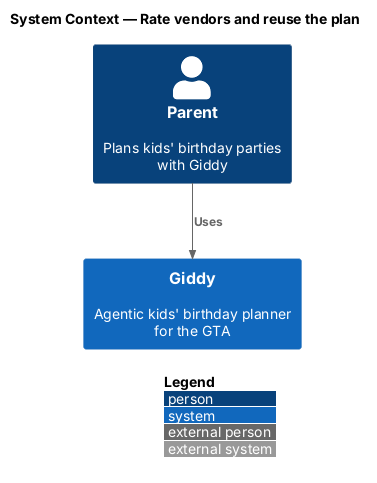
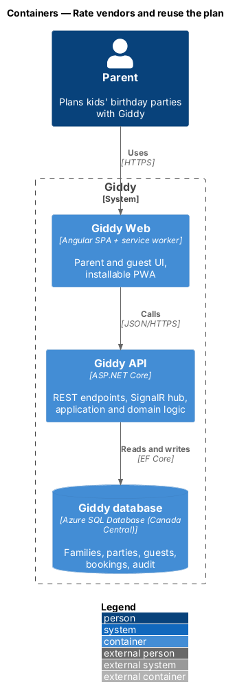
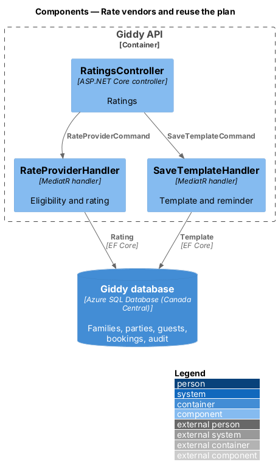
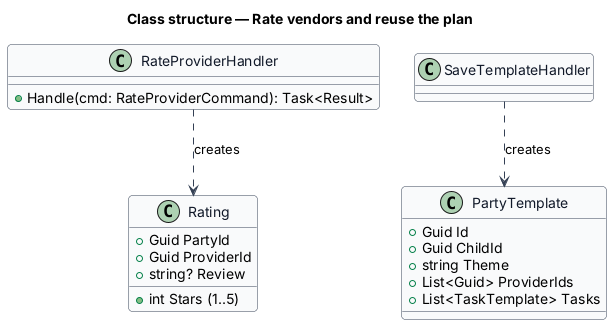
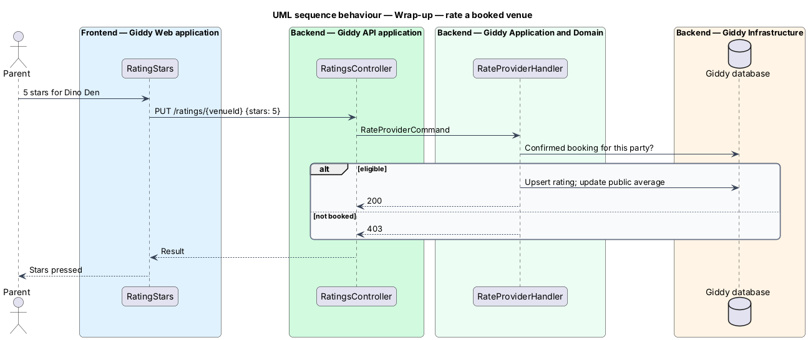

# Rate vendors and reuse the plan

## Overview

Parents rate the venue and vendors they actually booked, see final numbers, and save the plan as a *template* for next year, which also schedules a reminder about eight weeks before the child's next birthday.

- **template** — copy of a party's theme, vendors and checklist used to start a new draft

This feature belongs to the **Wrap-up** subsystem. It is designed from the screens in [`docs/mocks`](../../../mocks/README.md) and the L2 requirements listed below.

## Description

The feature is a vertical slice from the Angular web application through the Giddy API to storage and any external services.

**Frontend (Giddy Web)**

- **`RatingStars`** — 1–5 star buttons with `aria-pressed`.
- **`FinalNumbersCard`** — Kids, spend, gifts.
- **`SaveTemplateButton`** — Saves the template.

**Backend (Giddy API)**

- **`RatingsController`** — `PUT /api/parties/{id}/ratings/{providerId}`; only providers with a confirmed booking or accepted quote.
- **`SaveTemplateHandler`** — Copies the plan into a `PartyTemplate` and schedules a reminder.

## Requirements

The feature realizes the following level-2 (L2) requirements. Each L2 requirement refines the level-1 (L1) requirement cited beside it; the full acceptance criteria are in [`docs/specs/L2.md`](../../../specs/L2.md).

| L2 ID | Refines (L1) | Requirement |
|-------|--------------|-------------|
| `L2-053` | `L1-014` | **Rate venue and vendors.** Given wrap-up, when the parent rates a booked venue or vendor from 1 to 5 stars, then the rating is saved and counted in that business's public rating; a review text is optional. |
| `L2-054` | `L1-014` | **Final numbers and reuse.** Given wrap-up, when it is shown, then it lists how many kids came, the final spend against budget and the number of gifts logged. |

## Diagrams

### System context

Only parents and Giddy take part.

### Containers

A standard slice.

### Components

Rating and templating are separate handlers.

### Class structure

Ratings link a party to a provider.

### Behaviour — rate a booked venue

Ratings are accepted only for providers with a confirmed booking or accepted quote (`L2-053`).

