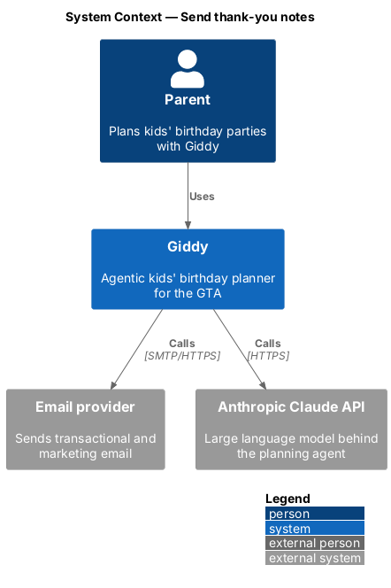
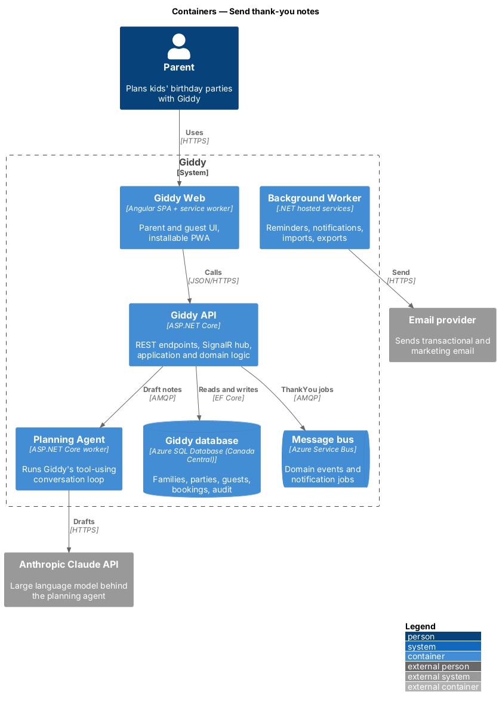
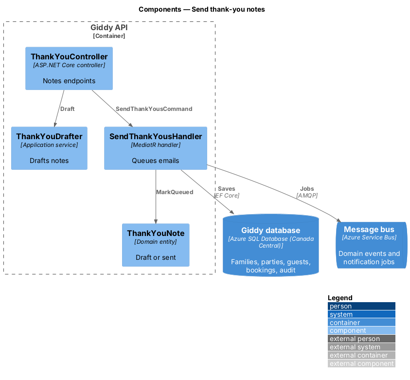
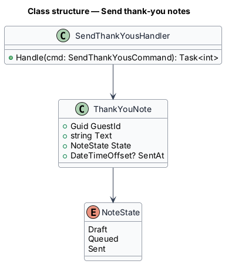
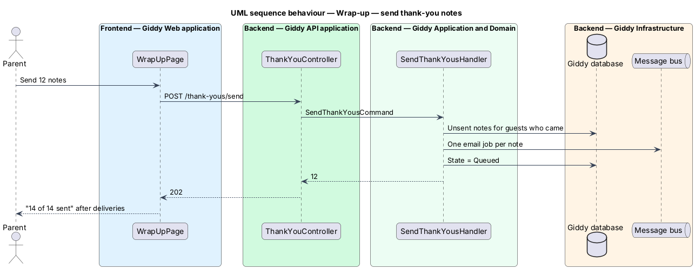

# Send thank-you notes

## Overview

After the party, Giddy drafts one *thank-you note* per guest who came, mentioning any logged gift. The parent edits and sends them by email in one go.

- **gift log** — optional note of what each guest gave, entered by the parent

This feature belongs to the **Wrap-up** subsystem. It is designed from the screens in [`docs/mocks`](../../../mocks/README.md) and the L2 requirements listed below.

## Description

The feature is a vertical slice from the Angular web application through the Giddy API to storage and any external services.

**Frontend (Giddy Web)**

- **`WrapUpPage`** — Route `/parties/{id}/wrap-up`; notes with Draft/Sent, Send all.

**Backend (Giddy API)**

- **`ThankYouController`** — `GET/PUT .../thank-yous`, `POST .../thank-yous/send`.
- **`ThankYouDrafter`** — Agent tool or template that drafts notes from the gift log.
- **`SendThankYousHandler`** — Queues one email per unsent note; marks Sent on delivery.

## Requirements

The feature realizes the following level-2 (L2) requirements. Each L2 requirement refines the level-1 (L1) requirement cited beside it; the full acceptance criteria are in [`docs/specs/L2.md`](../../../specs/L2.md).

| L2 ID | Refines (L1) | Requirement |
|-------|--------------|-------------|
| `L2-052` | `L1-014` | **Thank-you notes.** Given a party date has passed, when the parent opens Wrap-up, then Giddy has drafted one thank-you note per guest who came, mentioning the gift if one was logged, and each can be edited before sending. |

## Diagrams

### System context

Notes are drafted with the Claude API and sent by the email provider.

### Containers

Drafting runs in the Planning Agent; sending in the worker.

### Components

Drafting and sending are separate.

### Class structure

Notes move Draft → Queued → Sent.

### Behaviour — send thank-you notes

Only unsent notes are queued; delivery marks each Sent (`L2-052`).

